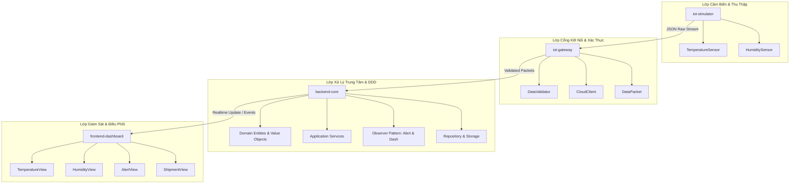

# ❄️ Cold Chain Logistics - Hệ thống Giám sát & Điều phối Chuỗi Cung ứng Lạnh IoT

[](https://en.cppreference.com/)
[](https://cmake.org/)
[](#-kiến-trúc-hệ-thống)
[](#-các-mẫu-thiết-kế-áp-dụng)

Hệ thống giám sát, quản lý và điều phối chuỗi cung ứng lạnh (**Cold Chain Logistics**) theo thời gian thực. Dự án được xây dựng dưới dạng **C++ Monorepo** chuẩn hóa, kết hợp thiết bị mô phỏng cảm biến IoT, cổng kết nối Gateway trung chuyển, lõi xử lý nghiệp vụ theo mô hình **Domain-Driven Design (DDD)** và giao diện điều khiển trung tâm Dashboard.

Mục tiêu đảm bảo tính toàn vẹn và chất lượng của các mặt hàng nhạy cảm với nhiệt độ (dược phẩm, vắc-xin, thực phẩm tươi sống, hóa chất sinh học) trong suốt vòng đời lưu kho và vận chuyển.

---

## 🏗️ Kiến trúc Hệ thống (4-Layer Monorepo Architecture)

Hệ thống được thiết kế theo mô hình phân tầng chặt chẽ kết hợp Clean Architecture và Event-Driven:



1. **Lớp Cảm biến & Thu thập (Sensing Layer - `iot-simulator`):**
   * Đóng vai trò là các node cảm biến gắn tại từng thùng hàng/container lạnh.
   * Áp dụng tính kế thừa và đa hình (OOP) từ lớp cơ sở `Sensor` cho `TemperatureSensor` và `HumiditySensor`.
   * Tạo sinh dữ liệu môi trường giả lập thời gian thực ngẫu nhiên theo phân phối thống kê (`<random>`, `<chrono>`).
   * Tự động tuần tự hóa dữ liệu thành chuỗi JSON chuẩn hóa (`SensorData::toJson()`).

2. **Lớp Cổng kết nối (Gateway Layer - `iot-gateway`):**
   * Đóng vai trò thiết bị biên (Edge Device / IoT Gateway) thu thập dữ liệu từ các node cảm biến lân cận.
   * Kiểm tra, làm sạch và xác thực tính hợp lệ của gói tin (`DataValidator`, `DataPacket`).
   * Đóng gói và truyền tải an toàn lên máy chủ trung tâm (`CloudClient`).

3. **Lớp Xử lý Trung tâm (Core & Business Layer - `backend-core`):**
   * **Domain-Driven Design (DDD):** Tách biệt rõ thực thể (`entities/ColdContainer`, `Shipment`, `Sensor`, `Route`), đối tượng giá trị (`value_objects/Temperature`, `Humidity`, `Location`) và sự kiện miền (`events/TemperatureExceeded`, `SensorDataReceived`).
   * **Application Services:** Điều phối luồng nghiệp vụ (`MonitoringService`, `AlertService`, `PredictionService`).
   * **Observer Pattern:** Bộ quan sát phát hiện vi phạm ngưỡng nhiệt độ/độ ẩm tức thời (`Subject`, `Observer`, `AlertObserver`, `DashboardObserver`).
   * **Data Access & Storage:** Triển khai Repository Pattern (`SensorDataRepository`, `ShipmentRepository`) và kết nối CSDL (`storage/Database`, `database.sql`).
   * **APIs / Endpoints:** Cung cấp giao diện tiếp nhận dữ liệu từ Gateway (`GatewayAPI`) và cung cấp dữ liệu cho Dashboard (`DashboardAPI`).

4. **Lớp Hiển thị & Điều phối (Presentation Layer - `frontend-dashboard`):**
   * Giao diện Dashboard trực quan hóa trạng thái toàn bộ chuỗi cung ứng lạnh.
   * Các view chuyên biệt: `TemperatureView`, `HumidityView`, `AlertView`, `ShipmentView`.
   * Quản lý tài nguyên giao diện trong `assets/icons` và `assets/images`.

---

## 📂 Cấu trúc Thư mục Chi tiết (Repository Structure)

Cấu trúc monorepo thực tế của dự án:

```text
cold-chain-logistics/
├── CMakeLists.txt                    # CMake cấu hình build root cho toàn bộ monorepo
├── README.md                         # Tài liệu hướng dẫn tổng quan dự án
│
├── config/                           # Cấu hình hệ thống tập trung
│   └── system_config.json            # Tham số vận hành chung của toàn hệ thống
│
├── iot-simulator/                    # [Layer 1] Phân hệ giả lập cảm biến IoT (C++)
│   ├── CMakeLists.txt                # Cấu hình biên dịch simulator
│   ├── config/
│   │   └── sensor_config.json        # Cấu hình chu kỳ đọc, ngưỡng dải đo cảm biến
│   ├── include/                      # Header files của phân hệ cảm biến
│   │   ├── Sensor.h                  # Lớp cha trừu tượng (Base Abstract Class)
│   │   ├── SensorData.h              # Struct bản tin đo & hàm đóng gói JSON
│   │   ├── TemperatureSensor.h       # Cảm biến nhiệt độ kế thừa từ Sensor
│   │   └── HumiditySensor.h          # Cảm biến độ ẩm kế thừa từ Sensor
│   └── src/                          # Mã nguồn triển khai
│       ├── Sensor.cpp
│       ├── SensorData.cpp            # Đóng gói JSON & format thời gian timestamp
│       ├── TemperatureSensor.cpp     # Sinh dữ liệu nhiệt độ ngẫu nhiên
│       ├── HumiditySensor.cpp        # Sinh dữ liệu độ ẩm ngẫu nhiên
│       └── main.cpp                  # Luồng chạy mô phỏng cảm biến đa thùng hàng
│
├── iot-gateway/                      # [Layer 2] Phân hệ Edge Gateway trung chuyển (C++)
│   ├── CMakeLists.txt                # Cấu hình biên dịch gateway
│   ├── config/
│   │   └── gateway_config.json       # Cấu hình kết nối mạng, buffer và endpoint
│   ├── include/                      # Header files của Gateway
│   │   ├── IoTGateway.h              # Lớp điều phối trung tâm Gateway
│   │   ├── DataValidator.h           # Bộ tiền kiểm định và lọc nhiễu dữ liệu
│   │   ├── DataPacket.h              # Định dạng gói tin trung chuyển
│   │   └── CloudClient.h             # Client đẩy dữ liệu lên backend-core
│   ├── src/                          # Mã nguồn triển khai Gateway
│   │   ├── IoTGateway.cpp
│   │   ├── DataValidator.cpp
│   │   ├── DataPacket.cpp
│   │   └── CloudClient.cpp
│   └── main.cpp                      # Điểm khởi chạy của phân hệ Gateway
│
├── backend-core/                     # [Layer 3] Phân hệ xử lý trung tâm (C++ DDD)
│   ├── CMakeLists.txt                # Cấu hình biên dịch backend-core
│   ├── config/
│   │   └── backend_config.json       # Tham số cấu hình server, ngưỡng cảnh báo
│   ├── domain/                       # Tầng miền nghiệp vụ (Domain Layer)
│   │   ├── entities/                 # Các thực thể nghiệp vụ cốt lõi
│   │   │   ├── ColdContainer.h       # Thùng/container bảo quản lạnh
│   │   │   ├── Shipment.h            # Lô hàng vận chuyển
│   │   │   ├── Sensor.h              # Thực thể cảm biến định danh
│   │   │   └── Route.h               # Lộ trình vận chuyển
│   │   ├── value_objects/            # Đối tượng giá trị bất biến (Value Objects)
│   │   │   ├── Temperature.h         # Đơn vị & giới hạn nhiệt độ
│   │   │   ├── Humidity.h            # Đơn vị & giới hạn độ ẩm
│   │   │   └── Location.h            # Tọa độ GPS / Vị trí trạm
│   │   └── events/                   # Sự kiện miền (Domain Events)
│   │       ├── SensorDataReceived.h  # Sự kiện nhận dữ liệu mới
│   │       └── TemperatureExceeded.h # Sự kiện vượt ngưỡng nhiệt độ an toàn
│   ├── application/                  # Tầng ứng dụng (Application Layer - Use Cases)
│   │   ├── MonitoringService.h/.cpp  # Nghiệp vụ giám sát liên tục
│   │   ├── AlertService.h/.cpp       # Nghiệp vụ xử lý và kích hoạt cảnh báo
│   │   └── PredictionService.h/.cpp  # Dự đoán xu hướng biến đổi nhiệt
│   ├── observer/                     # Cơ chế Observer Pattern
│   │   ├── Subject.h                 # Interface/Lớp phát sinh thông báo
│   │   ├── Observer.h                # Interface người quan sát
│   │   ├── AlertObserver.h/.cpp      # Observer xử lý chuông/cảnh báo khẩn
│   │   └── DashboardObserver.h/.cpp  # Observer đẩy cập nhật lên dashboard
│   ├── repository/                   # Tầng trừu tượng dữ liệu (Repository Pattern)
│   │   ├── SensorDataRepository.h/.cpp
│   │   └── ShipmentRepository.h/.cpp
│   ├── storage/                      # Tầng lưu trữ cơ sở dữ liệu
│   │   ├── Database.h/.cpp           # Trình bao bọc kết nối CSDL
│   │   └── database.sql              # Script DDL khởi tạo schema CSDL
│   ├── api/                          # Giao tiếp ngoại vi (API Controllers)
│   │   ├── GatewayAPI.h/.cpp         # API tiếp nhận gói tin từ IoT Gateway
│   │   └── DashboardAPI.h/.cpp       # API cung cấp dữ liệu cho Dashboard
│   └── main.cpp                      # Điểm khởi chạy của phân hệ Backend Core
│
├── frontend-dashboard/               # [Layer 4] Phân hệ giao diện giám sát & điều phối
│   ├── CMakeLists.txt                # Cấu hình biên dịch Dashboard
│   ├── assets/                       # Tài nguyên đồ họa
│   │   ├── icons/                    # Biểu tượng trạng thái, cảnh báo
│   │   └── images/                   # Hình ảnh minh họa container, bản đồ
│   ├── include/                      # Header files của giao diện
│   │   ├── Dashboard.h               # Bộ điều khiển trung tâm giao diện
│   │   ├── TemperatureView.h         # Màn hình theo dõi nhiệt độ
│   │   ├── HumidityView.h            # Màn hình theo dõi độ ẩm
│   │   ├── AlertView.h               # Màn hình danh sách cảnh báo sự cố
│   │   └── ShipmentView.h            # Màn hình thông tin lộ trình lô hàng
│   ├── src/                          # Triển khai mã nguồn giao diện
│   │   ├── Dashboard.cpp
│   │   ├── TemperatureView.cpp
│   │   ├── HumidityView.cpp
│   │   ├── AlertView.cpp
│   │   └── ShipmentView.cpp
│   └── main.cpp                      # Điểm khởi chạy của Dashboard
│
├── tests/                            # Phân hệ kiểm thử tự động (Unit & Integration)
│   ├── test-sensor/                  # Test độ chính xác và chuỗi hóa JSON cảm biến
│   ├── test-gateway/                 # Test tiền xử lý, lọc gói tin Gateway
│   ├── test-domain/                  # Test logic thực thể, Value Objects, quy tắc DDD
│   ├── test-observer/                # Test cơ chế đăng ký và nhận sự kiện Observer
│   └── test-integration/             # Test luồng tích hợp Sensor -> Gateway -> Backend -> Dashboard
│
└── docs/                             # Tài liệu phân tích và thiết kế hệ thống
    ├── architecture/                 # Sơ đồ kiến trúc tổng quan hệ thống
    ├── use-case/                     # Biểu đồ Use Case chức năng các tác nhân
    ├── class-diagram/                # Biểu đồ lớp UML chi tiết
    ├── sequence-diagram/             # Biểu đồ tuần tự luồng truyền tin và cảnh báo
    └── activity-diagram/             # Biểu đồ hoạt động quy trình nghiệp vụ
```

---

## ✨ Tính năng Nổi bật & Các Mẫu Thiết Kế

### 1. Phân hệ IoT Simulator
* **Lập trình Hướng đối tượng chuẩn mực:** Kế thừa từ `Sensor`, đa hình phương thức thuần ảo `readData()`.
* **Mô phỏng Phân phối ngẫu nhiên:** Sử dụng `std::mt19937` và `std::uniform_real_distribution` để sinh biến thiên nhiệt độ và độ ẩm thực tế.
* **Đóng gói JSON tích hợp:** Xử lý chuỗi và định dạng thời gian thực chuẩn ISO (`%d-%m-%YT%H:%M:%S`).

### 2. Phân hệ IoT Gateway
* **Tiền kiểm & Lọc dữ liệu (Data Validation):** Ngăn chặn các gói tin lỗi hoặc ngoại lai trước khi gửi về máy chủ.
* **Bộ đệm & Kết nối mạng:** Quản lý hàng đợi gói tin và đảm bảo khả năng truyền tin ổn định.

### 3. Phân hệ Backend Core (DDD & Clean Architecture)
* **Domain-Driven Design:**
  * **Entities:** Định danh duy nhất theo nghiệp vụ (`ColdContainer`, `Shipment`, `Route`).
  * **Value Objects:** Bất biến, tự xác thực tính hợp lệ của giá trị (`Temperature`, `Humidity`, `Location`).
  * **Domain Events:** Bắn sự kiện tức thời khi phát hiện vi phạm nhiệt độ (`TemperatureExceeded`).
* **Observer Pattern:** Tách rời hoàn toàn giữa bộ phân tích vi phạm và các module thụ hưởng (chuông cảnh báo `AlertObserver`, cập nhật màn hình `DashboardObserver`).
* **Repository Pattern:** Cách ly tầng lưu trữ CSDL khỏi logic nghiệp vụ, dễ dàng chuyển đổi CSDL.

### 4. Phân hệ Dashboard
* Giám sát trực quan trạng thái nhiệt độ, độ ẩm theo thời gian thực.
* Nhận diện và highlight trạng thái cảnh báo tức thời khi có lô hàng vượt ngưỡng an toàn.

---

## 🛠️ Công nghệ Sử dụng (Tech Stack)

| Hạng mục | Công nghệ / Tiêu chuẩn | Chi tiết áp dụng |
| :--- | :--- | :--- |
| **Ngôn ngữ cốt lõi** | C++ (C++17 / C++20) | Toàn bộ các phân hệ Simulator, Gateway, Backend, Dashboard, Tests |
| **Hệ thống Build** | CMake (>= 3.16) | Quản lý biên dịch Monorepo đa nền tảng (Windows / Linux / macOS) |
| **Trình biên dịch** | GCC (MinGW-w64), Clang, MSVC | Hỗ trợ đa luồng `<thread>`, `<chrono>`, chuẩn C++ hiện đại |
| **Kiến trúc phần mềm** | Clean Architecture / DDD | Entity, Value Object, Domain Event, Application Services |
| **Mẫu thiết kế** | Observer, Repository, Factory | Giảm độ phụ thuộc, dễ dàng mở rộng và bảo trì |
| **Định dạng dữ liệu** | JSON, SQL | Chuẩn hóa truyền tin giữa các node và lưu trữ CSDL |
| **Kiểm thử** | Unit Test & Integration Test | Phân chia rõ ràng cho Sensor, Gateway, Domain, Observer, Luồng tích hợp |

---

## 🚀 Hướng dẫn Biên dịch & Khởi chạy

### Điều kiện tiên quyết
* Cài đặt **CMake** (phiên bản `>= 3.16`).
* Cài đặt trình biên dịch C++ hỗ trợ C++17 trở lên:
  * **Windows:** MinGW-w64 (`g++`) hoặc Visual Studio C++ (MSVC).
  * **Linux:** `sudo apt install build-essential cmake`
  * **macOS:** Xcode Command Line Tools hoặc `brew install cmake gcc`.

---

### Cách 1: Biên dịch toàn bộ dự án với CMake (Khuyến nghị)

```bash
# 1. Clone repository
git clone https://github.com/hieuvuduc347/cold-chain-logistics.git
cd cold-chain-logistics

# 2. Tạo thư mục build và cấu hình
cmake -B build -S .

# 3. Tiến hành biên dịch toàn bộ các phân hệ
cmake --build build --config Release
```

---

### Cách 2: Biên dịch và chạy từng phân hệ độc lập

#### 1. Chạy phân hệ giả lập cảm biến (`iot-simulator`)
```bash
# Sử dụng trực tiếp trình biên dịch g++
cd iot-simulator
g++ -std=c++17 -Iinclude src/Sensor.cpp src/SensorData.cpp src/TemperatureSensor.cpp src/HumiditySensor.cpp src/main.cpp -o simulator -pthread

# Chạy simulator
# Trên Linux/macOS:
./simulator

# Trên Windows PowerShell / CMD:
.\simulator.exe
```

#### 2. Chạy phân hệ Gateway (`iot-gateway`)
```bash
cd iot-gateway
g++ -std=c++17 -Iinclude src/*.cpp main.cpp -o gateway -pthread
./gateway # hoặc .\gateway.exe trên Windows
```

#### 3. Chạy phân hệ Backend Core (`backend-core`)
```bash
cd backend-core
g++ -std=c++17 -I. application/*.cpp observer/*.cpp repository/*.cpp storage/*.cpp api/*.cpp main.cpp -o backend_core -pthread
./backend_core # hoặc .\backend_core.exe trên Windows
```

#### 4. Chạy phân hệ Dashboard (`frontend-dashboard`)
```bash
cd frontend-dashboard
g++ -std=c++17 -Iinclude src/*.cpp main.cpp -o dashboard -pthread
./dashboard # hoặc .\dashboard.exe trên Windows
```

---

## 🧪 Kiểm thử Hệ thống (Testing)

Dự án cung cấp bộ test case trong thư mục `tests/`:
* `tests/test-sensor/`: Kiểm tra độ phân giải, chu kỳ đọc và tính hợp lệ của bản tin JSON từ cảm biến.
* `tests/test-gateway/`: Kiểm tra thuật toán lọc nhiễu và đóng gói dữ liệu của Gateway.
* `tests/test-domain/`: Kiểm thử tính toàn vẹn của Value Objects và thực thể container.
* `tests/test-observer/`: Kiểm thử kích hoạt sự kiện khi phát hiện vi phạm nhiệt độ.
* `tests/test-integration/`: Kiểm thử luồng dữ liệu trọn vẹn từ cảm biến đến cảnh báo.

```bash
# Chạy bộ test sau khi build CMake
ctest --test-dir build --output-on-failure
```

---

## 🤝 Quy trình Phát triển & Phân nhánh (Git Workflow)

1. Tuân thủ mô hình **Gitflow**:
   * `main`: Nhánh ổn định, chứa các bản phát hành hoàn thiện.
   * `develop`: Nhánh tích hợp các tính năng đang phát triển.
   * `feature/*`: Nhánh tính năng cụ thể (ví dụ: `feature/iot-sensing`, `feature/gateway-validator`, `feature/backend-ddd`, `feature/dashboard-ui`).
   * `test/*`: Nhánh bổ sung test case (ví dụ: `test/sensor-unit-test`).
2. Mọi thay đổi phải thông qua **Pull Request (PR)**, vượt qua kiểm thử tự động và được ít nhất 1 thành viên kiểm duyệt (code review) trước khi merge.

---

## 👥 Tác giả & Đóng góp

* **Vũ Đức Hiếu** ([@hieuvuduc347](https://github.com/hieuvuduc347)) - Kiến trúc sư hệ thống & Phát triển phân hệ IoT C++.
* Đội ngũ phát triển dự án Cold Chain Logistics.

---

## 📄 Giấy phép (License)

Dự án được phân phối dưới giấy phép mã nguồn mở [MIT License](LICENSE).

